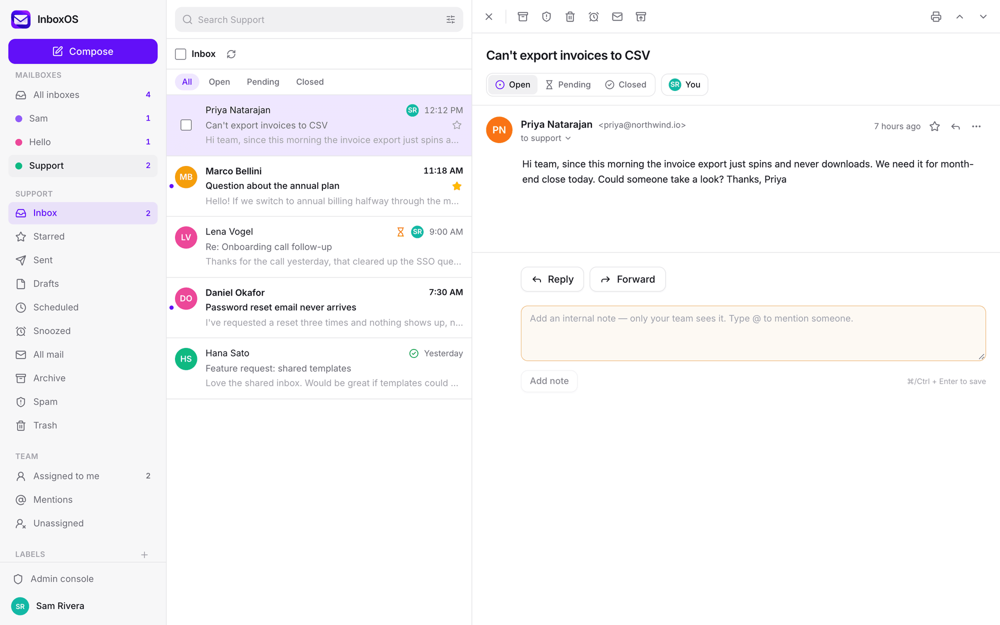
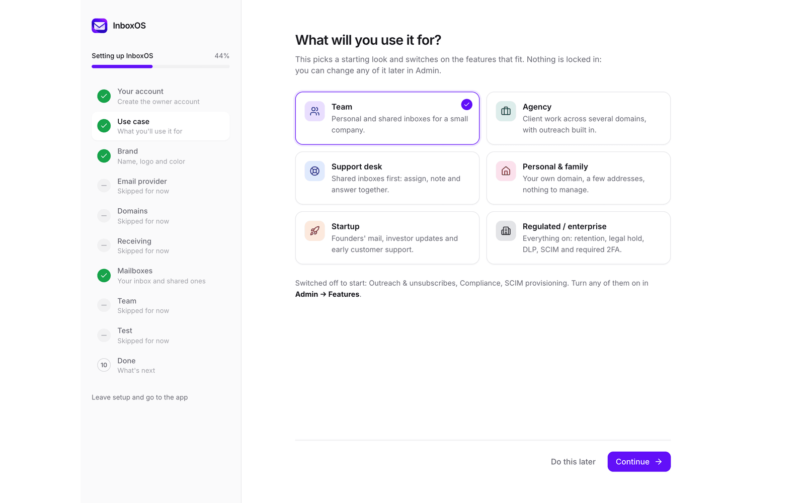
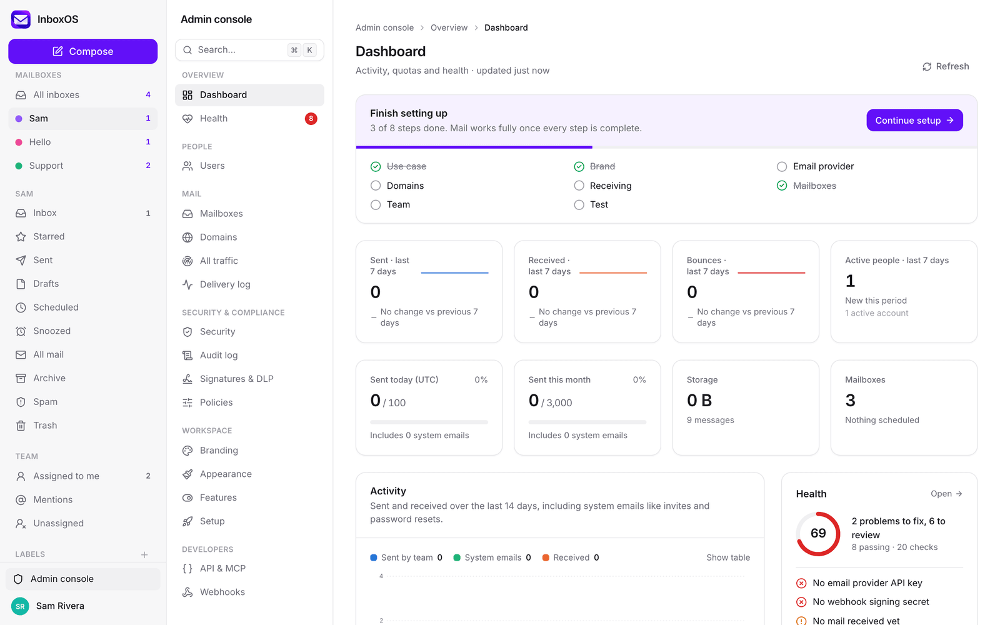
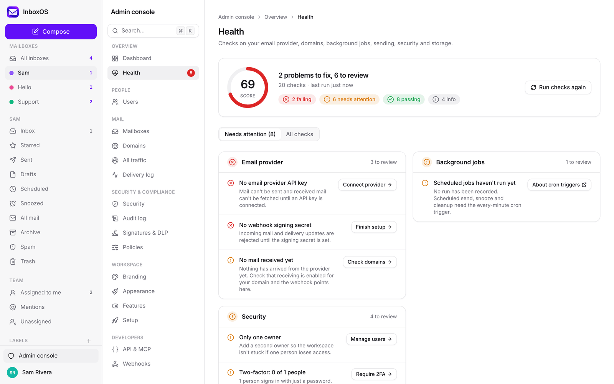
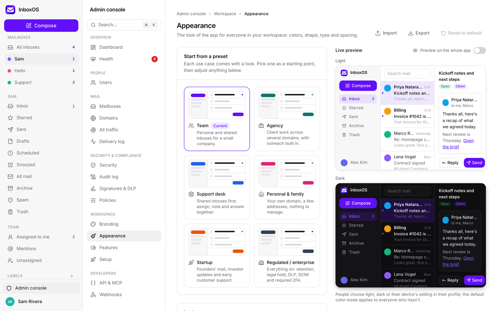
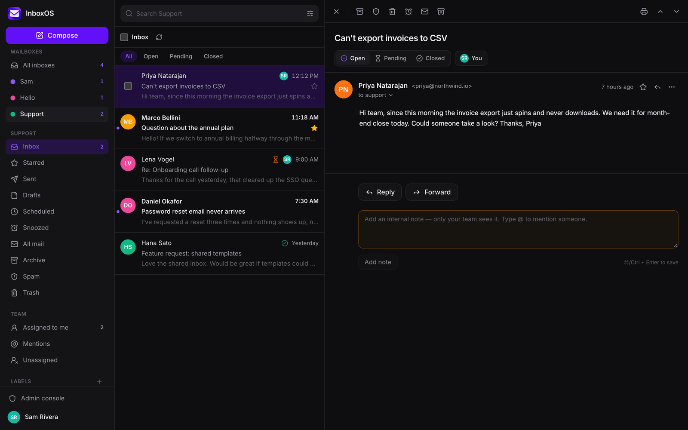
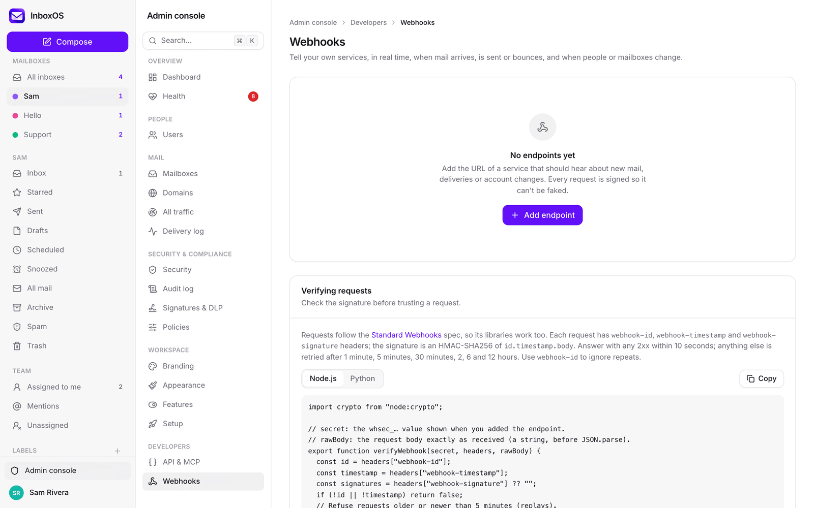
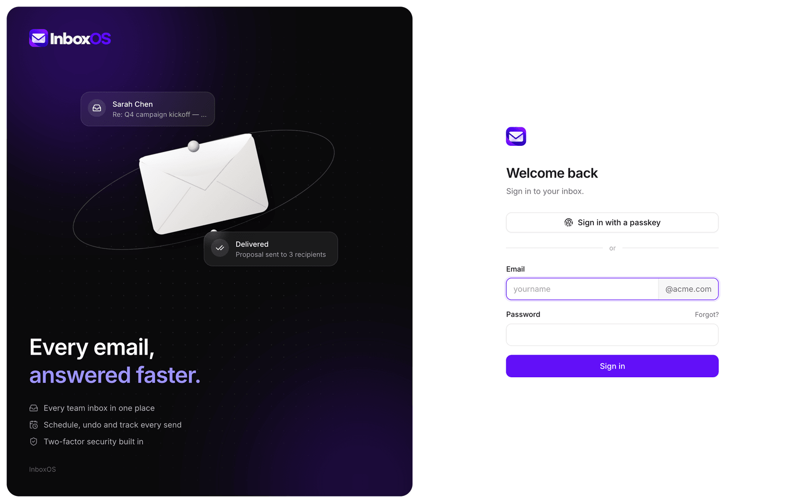

<h1 align="center">
  <picture>
    <source media="(prefers-color-scheme: dark)" srcset="public/brand/inboxos-wordmark.png" />
    
  </picture>
</h1>

<p align="center">
  <strong>Self-hosted email for your team, on your own domain.</strong><br />
  Personal and shared inboxes, a guided setup, a real admin console and a theme you control.<br />
  Runs on Cloudflare Workers, D1 and R2, and sends and receives through Resend.
</p>

<p align="center">
  <a href="./LICENSE"></a>
  
  
  
</p>

<p align="center">
  
</p>

---

## Why InboxOS

- **You own it.** Your mail, your database, your domain. One Worker on your Cloudflare account, no per-seat pricing.
- **Set up in the browser.** Deploy, open the URL, and a setup wizard walks you through everything else: owner account, branding, email provider, domains and DNS, mailboxes, invites and a live send/receive test.
- **Fits what you use it for.** Pick a use case (team, agency, support desk, personal and family, startup, regulated) and InboxOS sets a matching look and switches on the features that fit. Change anything later.
- **An admin console you'll actually open.** Health checks with one-click fixes, a dashboard, bulk actions, CSV import and export, and a ⌘K palette that gets you anywhere.

## Contents

- [Features](#features)
- [Screenshots](#screenshots)
- [How it works](#how-it-works)
- [Deploy](#deploy)
- [Run it locally](#run-it-locally)
- [The setup wizard](#the-setup-wizard)
- [Make it yours](#make-it-yours)
- [Email providers](#email-providers)
- [Webhooks](#webhooks)
- [API and MCP](#api-and-mcp)
- [Configuration reference](#configuration-reference)
- [Project structure](#project-structure)
- [Security](#security)
- [Keyboard shortcuts](#keyboard-shortcuts)
- [Troubleshooting](#troubleshooting)
- [Contributing](#contributing)
- [License](#license)

## Features

**Mail**
- Personal and shared mailboxes (`hello@`, `support@`) with owner, can-send and read-only access, plus an **All inboxes** view
- Several domains at once: every mailbox gets its address on each domain, and compose lets you pick which one to send from
- Aliases and an optional catch-all; mail for unknown addresses is kept, never lost
- Conversations, labels, stars, archive, spam, trash, snooze, and Gmail-style search (`from:` `to:` `subject:` `has:attachment` `is:unread` `before:` `after:` …)
- Rich-text compose with autosaved drafts, undo send, scheduled send, templates, signatures and attachment reminders
- Delivery timeline on sent mail: delivered, bounced, complained, opened, clicked
- Mail rules (filter, label, forward, auto-reply), vacation replies and blocked senders
- Installable on phones and desktops, with push notifications and optional unread digests

**Working together**
- Assign conversations, set them open, pending or closed, leave internal notes and @mention teammates
- Collision warnings when two people reply to the same conversation
- A team directory with profile photos, titles, departments, pronouns and local time

**Admin console**
- **Dashboard** with sent/received/bounce trends, quota meters and a setup checklist
- **Health center**: provider key, webhook, DNS, cron, quotas, bounce rates, 2FA coverage, storage and more, each with a fix
- **Users and mailboxes** with search, filters, sorting, bulk actions and CSV import/export
- **Domains** with live DNS checks (SPF, DKIM, MX, DMARC) and copy-ready records
- **All traffic**: every email across your domains in one view, including unrouted mail
- **Security center**: sessions, sign-in history, new-device alerts, IP allowlist, required 2FA, passkeys, Google sign-in and SCIM provisioning (Okta, Entra ID)
- **Compliance**: retention policies, legal holds and eDiscovery exports
- **Signatures and DLP**: company signatures, legal disclaimers and outbound data-loss rules
- Delivery and audit logs, both searchable and exportable
- **⌘K / Ctrl+K command palette** for pages, actions, people and mailboxes

**For developers**
- REST API with scoped keys, an MCP server, and signed outbound webhooks with retries

## Screenshots

| | |
|---|---|
|  |  |
| **Setup wizard**: from a fresh deploy to working mail | **Dashboard**: activity, quotas and setup progress |
|  |  |
| **Health center**: every problem with a fix | **Appearance**: presets, palettes and live previews |
|  |  |
| **Dark mode**, from the same theme tokens | **Webhooks**: signed, retried and logged |
|  | |
| **Sign-in**, with your name, logo and colors | |

## How it works

```
Browser (React app)  ──►  Cloudflare Worker (Hono API)  ──►  D1 (database)  ·  R2 (bodies, attachments, photos)
                                    │   ▲
                       send via API │   │ webhooks: email.received, delivered, bounced, opened…
                                    ▼   │
                                  Resend
```

- **Sending** goes through the Resend API. Scheduled mail, webhook retries and cleanup run from a cron trigger every minute.
- **Receiving**: Resend calls a webhook when mail arrives; the Worker fetches the message and files it into the right mailbox.
- **Statuses** arrive by webhook and update each message's timeline. Every webhook is signature-checked and de-duplicated.

## Deploy

You need a Cloudflare account (the free plan works) and Node 20+.

```bash
git clone https://github.com/DylanLambertson/InboxOS.git
cd InboxOS
npm install

# 1. Create the database and the storage bucket
npx wrangler d1 create inboxos                 # copy the database_id into wrangler.jsonc
npx wrangler r2 bucket create inboxos-files

# 2. One required secret: a long random string. Keep a copy; the setup wizard asks for it once.
openssl rand -base64 48 | tee /dev/tty | npx wrangler secret put SESSION_SECRET

# 3. Set APP_URL in wrangler.jsonc to the address you'll use, then deploy
npm run deploy
```

Open your Worker's URL. The setup wizard takes it from there.

To use your own hostname (for example `mail.example.com`), uncomment `routes` in `wrangler.jsonc`, or add it in the Cloudflare dashboard under **Workers → inboxos → Settings → Domains & Routes**. Keep `APP_URL` in step with it.

> Prefer a separate key for claiming the first owner account? Set `SETUP_TOKEN` with `npx wrangler secret put SETUP_TOKEN` and the wizard will ask for that instead of `SESSION_SECRET`.

## Run it locally

```bash
npm install
cp .dev.vars.example .dev.vars      # set SESSION_SECRET to any long string
npm run db:migrate:local
npm run dev
```

Open http://localhost:5173. You'll land in the setup wizard; the setup key is the `SESSION_SECRET` from `.dev.vars`. Without a Resend key you can use the whole interface; sending shows a clear "not connected" message.

## The setup wizard

The first visit to a fresh install opens `/setup`. Every step can be skipped and finished later from **Admin → Setup**; progress is saved on the server.

1. **Your account**: create the owner. A setup key proves you're the person who deployed the app, so nobody can claim a fresh URL before you.
2. **Use case**: pick what you'll use it for. This sets a starting theme and feature set.
3. **Brand**: company and app name, logo and accent color, with a live preview.
4. **Email provider**: paste a Resend API key. It's checked live and stored encrypted.
5. **Domains**: add your domain(s). InboxOS creates them in Resend, shows the DNS records to add (with tips for Cloudflare, Namecheap, GoDaddy, Route 53 and others, plus a zone file), checks them live, and warns if the domain already receives mail elsewhere.
6. **Receiving**: registers the inbound webhook for you and stores its signing secret.
7. **Mailboxes**: your own inbox plus suggested shared ones for your use case.
8. **Team**: invite people by pasting addresses.
9. **Test**: send a real email out, and a loopback test that waits for it to come back in.

## Make it yours

Everything people see comes from settings, not code. A fresh install wears the InboxOS logo and purple accent; rename the app in the setup wizard and the logo steps aside for your initials until you upload your own.

| Where | What |
|---|---|
| **Admin → Branding** | Company and app name, logo, monogram, sign-in headline, support email, footer, default sender name, previews of every system email |
| **Admin → Appearance** | Use-case presets, accent, corner radius, density, fonts, text size, default color mode, and full light and dark palettes with contrast warnings. Bright accents stay readable: links and highlights automatically use a deeper shade on light backgrounds. Import and export themes as JSON. |
| **Admin → Features** | Turn features on or off for the whole workspace. Off means hidden in the UI and refused by the API; nothing is deleted. |
| **Settings → Profile** | Each person's photo, title, pronouns, time zone, color mode and density |

Themes are plain JSON (see `shared/theme.ts`), so you can keep them in version control or share them:

```json
{ "accent": "#0f766e", "radius": "lg", "density": "comfortable", "fontFamily": "\"Inter\", system-ui, sans-serif",
  "googleFont": "Inter", "fontScale": 1, "defaultMode": "system", "light": {}, "dark": { "bg": "#0b0f0e" } }
```

## Email providers

InboxOS uses [Resend](https://resend.com) for sending and receiving. The free plan allows 100 emails a day and 3,000 a month; the app enforces whatever limits you set in **Admin → Policies**, so you never hit provider errors. Raise them after upgrading.

All provider code lives behind a small interface (`worker/lib/resend.ts` for the API, `worker/lib/provider-config.ts` for credentials). Adding another provider, such as Postmark, Amazon SES or Mailgun, means implementing sending, inbound parsing and delivery events in one adapter. Pluggable providers are on the roadmap, and contributions are welcome.

## Webhooks

**Admin → Webhooks** sends signed HTTP notifications to your own services when things happen: `message.received`, `message.sent`, `message.delivered`, `message.bounced`, `message.complained`, `message.opened`, `message.clicked`, `user.created`, `user.disabled`, `user.deleted`, `mailbox.created`, `mailbox.deleted`.

Requests follow the [Standard Webhooks](https://www.standardwebhooks.com) spec (`webhook-id`, `webhook-timestamp` and `webhook-signature` headers), so any Standard Webhooks library can verify them. Failed deliveries are retried with backoff for about a day; every attempt is logged and can be redelivered from the admin page, which also shows verification code for Node and Python.

## API and MCP

Create keys in **Admin → API & MCP**. Keys are scoped (`send`, `contacts`, `read`) and can be limited to specific mailboxes.

- **REST**: `https://<your-app>/api/v1/…` with `Authorization: Bearer <key>`: send email (with attachments, scheduling and replies), read messages and threads, manage contacts and the do-not-email list.
- **MCP**: point any MCP client at `https://<your-app>/mcp` with the same bearer key. Tools cover sending, drafts, reading and triaging mail, and contacts.

## Configuration reference

| Name | Kind | Required | What it does |
|---|---|---|---|
| `APP_URL` | var | yes | Public URL of the app, used for links, OAuth and webhooks |
| `SESSION_SECRET` | secret | yes | Signs links and encrypts stored credentials. Also the default setup key. |
| `SETUP_TOKEN` | secret | no | A separate setup key for creating the first owner |
| `RESEND_API_KEY` | secret | no | Overrides the key entered in the setup wizard |
| `RESEND_WEBHOOK_SECRET` | secret | no | Overrides the signing secret captured by the setup wizard |
| `GOOGLE_CLIENT_ID` / `GOOGLE_CLIENT_SECRET` | secret | no | Enables Google sign-in (redirect URI: `<APP_URL>/api/auth/google/callback`) |
| `VAPID_PRIVATE_JWK` | secret | no | Enables push notifications |

## Project structure

```
inboxos/
├── shared/        # Types and pure logic used by both the Worker and the app (theme, workspace, setup, CSV…)
├── worker/        # Cloudflare Worker: Hono API, inbound webhooks, cron
│   ├── lib/       # auth, sessions, 2FA, passkeys, Resend, sending, inbound, DNS, webhooks, health…
│   └── routes/    # REST endpoints
├── src/           # React app
│   ├── components/  # UI kit, compose, mail viewer, layout, command palette, setup pieces
│   └── pages/       # Mail, Setup, Settings, Admin, People, Auth
├── migrations/    # D1 schema
├── scripts/       # bootstrap.mjs: recover access if you're locked out
├── tests/         # unit tests (Vitest)
└── wrangler.jsonc # Cloudflare config
```

| Command | Does |
|---|---|
| `npm run dev` | App and API locally with hot reload |
| `npm run build` | Production build |
| `npm run deploy` | Build, apply database migrations and deploy |
| `npm run typecheck` | TypeScript checks for the app and the Worker |
| `npm test` | Unit tests |
| `npm run db:migrate:local` / `:remote` | Apply database migrations |
| `npm run bootstrap:local` / `:remote` | Reset an owner's password and role (recovery) |

## Security

- Passwords hashed with PBKDF2-SHA256, account lockout and rate-limited sign-in; passkeys and TOTP two-factor with recovery codes
- HttpOnly, SameSite session cookies stored as hashes; cross-site requests are refused
- Provider credentials and webhook secrets are encrypted at rest (AES-GCM, key derived from `SESSION_SECRET`)
- Incoming mail is sanitized and shown in a sandboxed frame with remote images blocked until you allow them, under a strict Content Security Policy
- Every inbound webhook's signature and timestamp are checked; replays are rejected
- Admins can't read other people's mailboxes without adding themselves, and that's recorded in the audit log

Found a vulnerability? Please report it privately through GitHub's **Report a vulnerability** on this repository rather than opening a public issue.

## Keyboard shortcuts

`⌘/Ctrl+K` go to anything · `c` compose · `/` search · `j`/`k` next/previous · `e` archive · `#` delete · `!` spam · `b` snooze · `s` star · `r` reply · `a` reply all · `f` forward · `g i` inbox · `⌘/Ctrl+Enter` send · `?` all shortcuts

## Troubleshooting

Start with **Admin → Health**: it checks most of what can go wrong and links to the fix.

| Symptom | Fix |
|---|---|
| "No email provider API key" | Finish the **Email provider** step in Admin → Setup, or set `RESEND_API_KEY` |
| Incoming mail never shows up | Check the MX record in Admin → Domains and the webhook in Admin → Setup. Mail for addresses without a mailbox waits in **Admin → All traffic → Unrouted**. |
| "Scheduled jobs haven't run" | Cron triggers only run on deployed Workers; check `triggers` in `wrangler.jsonc` |
| "Daily sending limit reached" | Raise the limits in Admin → Policies after upgrading your Resend plan |
| Lost the setup key | Set a new one: `npx wrangler secret put SETUP_TOKEN` |
| Locked out | `npm run bootstrap:remote -- --email you@example.com` resets your password and owner role |

## Contributing

Issues and pull requests are welcome. Before opening a PR, run:

```bash
npm run typecheck && npm test && npm run build
```

Keep changes focused, match the surrounding style, and add tests for new logic.

## License

InboxOS is free software, licensed under the [GNU Affero General Public License v3.0](./LICENSE).
You can use, modify and self-host it freely. If you run a modified version as a service for others, you must make your changes available under the same license.

Copyright © 2026 Dylan Lambertson. Open-source dependencies remain under their own licenses.
